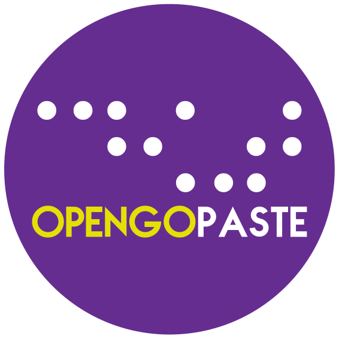

# OpenGoPaste

<p align="center">
    
</p>

## Installation

The Go dependencies are declared in `server/go.mod` and downloaded by the build
itself, there is nothing to install by hand:

```bash
git clone https://github.com/leblanc-simon/open-go-paste
cd open-go-paste/server
go run .
```

## Usage

### Basic launch

First, build binary :

```bash
cd open-go-paste/server
go build -o open-go-server *.go
```

Then, launch server :

```bash
./open-go-server
```

The server will be launched at `http://127.0.0.1:8080` and the datas directory will be `../datas` relative to the current working drectory.

The templates and the assets are embedded in the binary (`//go:embed`), so it can
be deployed on its own: the paste storage is the only thing it needs next to it.

### Options

Options come from `config.yaml` when that file sits next to the binary, from the
environment otherwise. `-c <path>` points at another file, and `./open-go-paste
--help` prints the authoritative list of the variables with their defaults.

* Customize listen IP : `OPEN_GO_PASTE_HOST=0.0.0.0`
* Customize listen port : `OPEN_GO_PASTE_PORT=3000`
* Customize datas directory : `OPEN_GO_PASTE_DATAS_FOLDER=/var/open-go-paste/datas`
* Customize CSS : `OPEN_GO_PASTE_CUSTOM_CSS="/static/css/custom.css"`
* Override the embedded assets : `OPEN_GO_PASTE_ASSETS_FOLDER=/var/open-go-paste/assets`
* Customize clean datas CRON : `OPEN_GO_PASTE_CRON="0 0 0 * * *"` (CRON syntax with seconds)
* Log level : `OPEN_GO_PASTE_LOG_LEVEL=info` (`debug|info|warn|error`, defaults to `error`)
* Log format : `OPEN_GO_PASTE_LOG_FORMAT=json` (`text|json`)
* Include the source position in the logs : `OPEN_GO_PASTE_LOG_SOURCE=true`

`OPEN_GO_PASTE_SERVER` was renamed `OPEN_GO_PASTE_HOST`. The old name still
works and prints a deprecation notice; it will be dropped in the next major
version.

The default log level is `error`, so a healthy start is silent. Set
`OPEN_GO_PASTE_LOG_LEVEL=info` to see the listen address, the resolved paste
folder and the cleanup schedule.

The same settings in a `config.yaml`:

```yaml
web:
  host: 0.0.0.0
  port: 3000
logging:
  level: info
  format: json
paste:
  datas_folder: /var/open-go-paste/datas
  custom_css: /static/css/custom.css
  cron: "0 0 0 * * *"
```

### Custom CSS

`OPEN_GO_PASTE_CUSTOM_CSS` takes either an absolute url, served as is, or a
`/static/...` path. That path is resolved against the assets, and the assets live
in the binary: `custom.css` is written by the operator, so it is deliberately
left out of it. Point `OPEN_GO_PASTE_ASSETS_FOLDER` at a folder holding
`css/custom.css` and it will be served — that folder takes precedence over the
embedded assets, file by file, which is also handy to edit the front end without
rebuilding. The server traces a custom stylesheet that resolves to nothing at
startup, rather than letting the page 404 on it.

### Internationalisation

In template, we use the function `trans`. To extract string, use `release/extract-message-from-template.sh`
(it needs `gotext` : `go install golang.org/x/text/cmd/gotext@latest`).

### Front end dependencies

`highlight.js` and `showdown` are committed under `assets/js`, and their versions
are declared in `package.json` so that a dependency scanner can see them. To
apply a new version, bump it in `package.json` then run `npm run vendor`
(`release/vendor-assets.sh`), and check a code paste and a markdown paste in a
browser.

### Tests

```bash
cd server && go test -race ./...   # server
npm install && npm test            # crypto and markdown sanitizer
```

## Thanks

* https://highlightjs.org/
* https://github.com/showdownjs/showdown
* https://ionicons.com/ (Copy and mail icons are licensed under MIT)

## Authors

* Simon Leblanc <contact@leblanc-simon.eu> (Code and design)
* Lucie Lenfant (Logos)

## License

* Code : [WTFPL](http://www.wtfpl.net/)
* Logos : [Art Libre](http://artlibre.org/)
